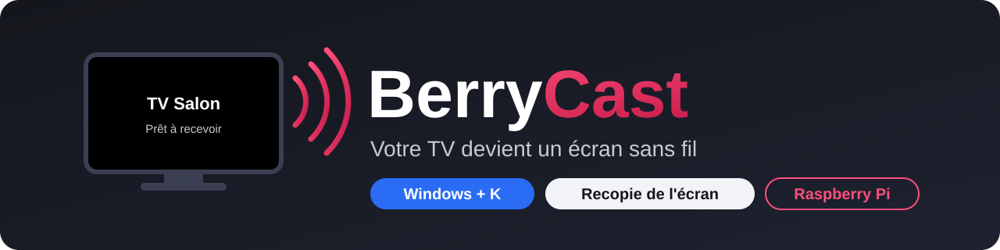

**Français** · [English](README.en.md)


BerryCast transforme un **Raspberry Pi** branché en HDMI sur une TV en **écran sans fil** :

- 💻 depuis un **PC Windows 10 ou 11** : **Windows + K** (« Diffuser »), puis le nom de votre BerryCast ;
- 📱 depuis un **iPhone, iPad ou Mac** : **« Recopie de l'écran »**, puis le nom de votre BerryCast.

Rien à installer sur le PC ni sur l'iPhone. Aucune ligne de commande pour l'utiliser.

> [!NOTE]
> **En développement.** Windows + K et la recopie de l'iPhone (portrait et paysage) fonctionnent
> sur un Raspberry Pi 3 B. Une **image de développement** est publiée dans les
> [*Releases*](https://github.com/fraizze/berrycast/releases) (pré-version « dev »).

## 🍓 Modèles compatibles

Seuls les modèles avec **Wi-Fi intégré** fonctionnent.

| Modèle | État |
|---|---|
| Raspberry Pi 3 Model B | ✅ testé (modèle principal) |
| Pi 3 A+, 3 B+, 4 B, 5, Zero 2 W | 🟡 prévu, pas encore testé |
| Pi Zero W | ⏳ plus tard (« best effort ») |
| Pi 1, Pi 2, Zero sans « W » | ❌ pas de Wi-Fi |

## 🚀 Installation

Il vous faut : un Raspberry Pi compatible, une **microSD** (8 Go ou plus), un câble **HDMI**,
l'alimentation du Pi, un **clavier USB** (pour le premier démarrage) et un ordinateur.

1. **Téléchargez l'image** `berrycast-dev-….img.xz` dans les
   [*Releases*](https://github.com/fraizze/berrycast/releases). Inutile de la décompresser.
2. **Flashez-la** sur la microSD avec [balenaEtcher](https://etcher.balena.io/) :
   *Flash from file* → *Select target* (votre microSD) → *Flash!*
3. **Branchez** la microSD, le clavier USB, le HDMI, puis l'alimentation.
4. **Remplissez le formulaire sur la TV**, au clavier : disposition du clavier, nom de l'appareil
   (ex. « TV Salon »), Wi-Fi, mot de passe du Wi-Fi, pays.

> [!TIP]
> Pas de clavier ? Remplissez le fichier `berrycast-wifi.txt` de la carte microSD avec le
> Bloc-notes avant le premier démarrage (voir [docs/image-dev.md](docs/image-dev.md)).

## 📺 Diffuser

| Depuis | Faites | Code |
|---|---|---|
| 💻 PC Windows 10 / 11 | **Windows + K**, puis « TV Salon » | aucun (le PC doit être sur le même Wi-Fi) |
| 📱 iPhone / iPad / Mac | **Recopie de l'écran**, puis « TV Salon » | 4 chiffres affichés en grand sur la TV, la 1re fois |

## ⚠️ Limites connues

> [!WARNING]
> - **Pas de contenus protégés** (Netflix, Disney+, Prime Video…) : ils afficheront un écran noir
>   ou un message d'erreur. Ces services exigent une protection anti-copie (HDCP côté Windows,
>   FairPlay côté Apple) réservée aux appareils certifiés et payants ; un logiciel libre ne peut
>   pas l'obtenir, et la contourner serait illégal. Regardez-les plutôt avec l'application de la TV.
> - **Une seule diffusion à la fois.**
> - Sur **Pi 3**, l'image Windows est en **720p** (son Wi-Fi 2,4 GHz ne suffit pas pour du 1080p fluide).

## 🛠️ Pour les développeurs

Mettre à jour un Pi **sans reflasher** (🖥️ PC — PowerShell, une commande à la fois) :

```powershell
git -C C:\Users\<votre-nom>\code\berrycast archive --format=tar.gz -o "$env:TEMP\berrycast.tgz" HEAD
```

```powershell
scp "$env:TEMP\berrycast.tgz" pi@berrycast.local:/tmp/
```

```powershell
ssh -t pi@berrycast.local "rm -rf /tmp/bc && mkdir -p /tmp/bc && tar xzf /tmp/berrycast.tgz -C /tmp/bc && sudo bash /tmp/bc/scripts/dev-update.sh /tmp/bc"
```

Lire le journal de la diffusion Windows :

```powershell
ssh pi@berrycast.local "sudo journalctl -u berrycast-miracast --since '-5min' --no-pager | tail -n 40"
```

Détails : [docs/image-dev.md](docs/image-dev.md) · [docs/test-diffusion.md](docs/test-diffusion.md) ·
envie d'aider ? [CONTRIBUTING.md](CONTRIBUTING.md)

## 🙏 Remerciements et licence

Miracast s'inspire de [lazycast](https://github.com/homeworkc/lazycast) (Hsun-Wei Cho, GPL-3.0) ;
AirPlay utilise [UxPlay](https://github.com/FDH2/UxPlay) (GPL-3.0).

BerryCast est un logiciel libre sous licence **GPL-3.0-or-later** ([LICENSE](LICENSE)).
